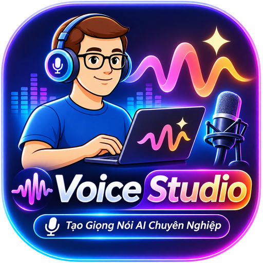

  
  <h1>Voice Studio - Mr.Huỳnh</h1>
  
<strong>Tạo giọng nói AI chuyên nghiệp ngay trên máy tính của bạn</strong>

  
Nhân bản giọng · Thiết kế giọng · Lồng tiếng video · Đọc truyện, sách nói · Chuyển giọng nói thành văn bản

## Tải về

Vào mục **Releases** của repo này, tải file `VoiceStudio-MrHuynh-<phiên bản>-win-x64.exe` rồi chạy để cài đặt.
Lần mở đầu tiên, ứng dụng sẽ tự cài phần lõi, engine giọng nói **VoxCPM2** (30 ngôn ngữ, có tiếng Việt,
giấy phép Apache-2.0) và tải mô hình (cần mạng, khoảng 15 GB dung lượng trống). Máy có card NVIDIA
chạy nhanh hơn nhiều; máy chỉ có CPU vẫn chạy được nhưng chậm.

Bộ cài chưa được ký số, nên Windows SmartScreen có thể hiện cảnh báo: bấm **More info → Run anyway**.

## Bản quyền và kích hoạt

- Cài xong là **dùng thử miễn phí 24 giờ**, không cần key. Góc trái màn hình hiện thời gian còn lại.
- Hết 24 giờ, ứng dụng hiện **mã máy** (dạng `VSMH-XXXX-XXXX-XXXX-XXXX`). Gửi mã này cho Mr.Huỳnh
  qua một trong các kênh bên dưới để nhận **key kích hoạt vĩnh viễn**, rồi dán key vào ứng dụng.
- Key chỉ dùng được trên đúng máy có mã máy đó. Cài lại Windows hoặc thay bo mạch chủ sẽ đổi mã máy,
  khi đó hãy gửi mã mới để được cấp lại key.

## Hỗ trợ

| Kênh | Liên kết |
|---|---|
| Facebook | https://facebook.com/mr.huynhxuyenson |
| Telegram | https://t.me/mrhuynh1985 |
| YouTube | https://www.youtube.com/channel/UCwSbzgfgu1iMfOR__AB4QGQ?sub_confirmation=1 |
| Website | https://mrhuynh.net |
| Nhóm Zalo | https://zalo.me/g/lzcnxj126 |
| Zalo | https://zalo.me/0979007367 |

## Tự build bộ cài Windows

1. Mở tab **Actions** của repo, chọn **Build Windows (Voice Studio - Mr.Huỳnh)**.
2. Bấm **Run workflow**. Sau khoảng 30–50 phút, file `.exe` có trong mục **Artifacts** của lần chạy
   và (nếu để bật "publish") trong mục **Releases**.

## Giấy phép

Voice Studio - Mr.Huỳnh dựa trên [VoiceStudio](https://github.com/debpalash/VoiceStudio)
© Palash Debnath và cộng sự, phát hành theo giấy phép **GNU AGPL-3.0** (xem [LICENSE](LICENSE)
và [LICENSE-NOTICE.md](LICENSE-NOTICE.md)). Mã nguồn của bản đã sửa này được công khai trong repo này
theo đúng giấy phép đó. Mô hình AI tải về có giấy phép riêng của từng mô hình
(OmniVoice và NLLB là CC-BY-NC, không dùng cho mục đích thương mại, nên không còn được cài mặc định).

README gốc của VoiceStudio: [README.upstream.md](README.upstream.md).
